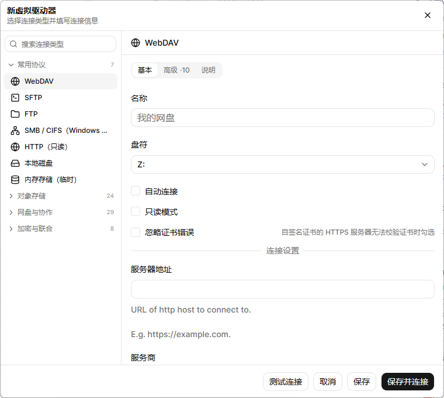

<div align="center">
  
  <h1>RcloneDrive</h1>
  <p><strong>把云端存储挂载成本地盘符的跨平台桌面工具，基于 Go + Wails v3，内嵌 rclone 引擎。</strong></p>
  <p>rclone 全部 68 种连接类型 · 托盘常驻 · 系统通知 · 开源免费</p>
  <p>
    <a href="https://github.com/younland/RcloneDrive/releases"></a>
    <a href="LICENSE"></a>
    <a href="https://go.dev"></a>
    <a href="https://v3.wails.io"></a>
    <a href="https://vuejs.org"></a>
    <a href="#install"></a>
  </p>
  <p>
    <a href="#screenshots">应用截图</a> ·
    <a href="#drives">虚拟驱动器</a> ·
    <a href="#manage">驱动器管理</a> ·
    <a href="#tray">托盘与通知</a> ·
    <a href="#settings">设置</a> ·
    <a href="#ui">界面</a> ·
    <a href="#install">安装</a> ·
    <a href="#build">构建</a> ·
    <a href="#protocols">协议 TODO</a>
  </p>
</div>

<br/>

### 🗂️ 像本地磁盘一样访问云端

把 WebDAV、SFTP、FTP 等远程存储挂载为系统磁盘：Windows 上是盘符（如 `Z:`），macOS 与 Linux 上是挂载目录。挂载完成后，任何程序都能像读写本地文件一样读写云端文件。

### 🔌 内嵌 rclone 引擎，无需单独安装

rclone 以 Go 依赖库的形式接入（`github.com/rclone/rclone`），既不需要安装或管理外部 rclone 可执行文件，也不依赖命令行配置；远程存储的配置以标准 rclone INI 格式保存，可与其他 rclone 程序共用。

### 🖥️ 托盘常驻、系统通知与单实例

关闭主窗口只是隐藏到托盘，挂载与传输继续在后台运行。托盘菜单实时显示每台驱动器的连接状态，随时可以连接、断开或编辑。挂载断开、检查更新等后台事件使用系统原生通知；同一时间只运行一个实例。

<br/>

<a id="screenshots"></a>

## 📷 应用截图

<div align="center">

<p><strong>主界面</strong> —— 卡片列出全部虚拟驱动器，显示协议、挂载状态与盘符，已挂载的卡片还会显示容量与可用空间；卡片右侧可直接打开挂载目录、挂载 / 断开、编辑与删除</p>


<br/>
<br/>

<p><strong>新增虚拟驱动器</strong> —— 左侧是按用途分组的连接类型树（可搜索），右侧按「基本 / 高级 / 说明」三个 tab 填写配置，底部可「测试连接」「保存」或直接「保存并连接」</p>



<br/>
<br/>

<p><strong>设置</strong> —— 主题（跟随系统 / 浅色 / 深色）与开机自启</p>


</div>

<a id="drives"></a>

## 🗂️ 虚拟驱动器

在「新虚拟驱动器」窗口左侧的连接类型树里选一种类型（rclone 全部后端按用途分组，可搜索），右侧按「基本 / 高级 / 说明」三个 tab 填写配置，即可把它挂载成本地盘符或挂载目录。挂载由内嵌 rclone 的 `cmount` 实现，底层使用系统的文件系统驱动。

| 连接类型分组 | 说明 |
|---|---|
| **常用协议** | WebDAV、SFTP、FTP、SMB / CIFS、HTTP、本地磁盘、内存存储 |
| **对象存储** | S3 兼容存储（含阿里云 OSS、腾讯云 COS、七牛、华为 OBS 等服务商预设）、Azure Blob / Files、Google Cloud Storage、Oracle、Swift、B2、Storj 等 |
| **网盘与协作** | Google Drive、OneDrive、Dropbox、Box、MEGA、pCloud、Yandex、Proton Drive、Koofr、Jottacloud、Google 相册 等（部分需要授权） |
| **加密与联合** | crypt（加密）、alias（别名）、union / combine（合并）、chunker、hasher、compress、cache |

字段列表直接来自 rclone 自己的后端定义：标了 `Advanced` 的进「高级」tab，枚举类型渲染成下拉框，密码类字段自动打码。需要 OAuth 授权的类型会标上「需授权」，可在「说明」tab 里看到用 `rclone authorize` 获取 token 的指引。

每台驱动器可单独设置：

- **挂载点**：Windows 为盘符（下拉框自动过滤已占用与已分配给其他驱动器的盘符），macOS 与 Linux 为挂载目录。
- **只读挂载**：挂载后禁止写入，适合只读分享或防止误操作。
- **忽略证书错误**：自签名证书的 HTTPS 服务器（自建 NAS、内网服务）可勾选此项目，挂载时跳过 TLS 证书校验；只对勾选的驱动器生效，不影响其他驱动器与系统信任库。
- **开机自动连接**：应用启动后自动挂载；配合开机自启，登录后挂载即已就绪。
- **高级参数**：类型专属的调优参数（超时、分块、编码、校验等）在「高级」tab 里。

> [!NOTE]
> 不需要单独安装 rclone，也不需要手动维护 `rclone.conf`——应用会按填写的字段生成并保存配置。

<a id="manage"></a>

## 🧩 驱动器管理

主界面以卡片列出全部虚拟驱动器，每张卡片显示名称、协议、连接状态与当前盘符，并可直接操作：

| 操作 | 说明 |
|---|---|
| **挂载 / 断开** | 卡片上的插头按钮；挂载中会显示进度指示 |
| **编辑** | 打开该驱动器的编辑窗口 |
| **删除** | 二次确认后移除，同时卸载挂载并删除本地配置 |

「测试连接」会在保存前实际建立连接并列举根目录，确认地址与账号可用后再保存。

> [!IMPORTANT]
> **已连接的驱动器不能直接编辑。** 点编辑时会先弹确认框，选择「断开并编辑」后自动断开连接并打开编辑窗口；选择「取消」则保持连接。即使编辑窗口已经打开，保存时后端也会拒绝在已连接状态下改写配置，避免连接中途换配置。

<a id="tray"></a>

## 🖥️ 托盘与通知

关闭主窗口不会退出程序，而是收进系统托盘继续在后台运行（开机自启时带 `--tray` 直接静默进托盘）。

| 托盘菜单项 | 说明 |
|---|---|
| `RcloneDrive v…` | 当前版本（不可点击） |
| **显示主界面** | 从托盘恢复主窗口 |
| **检查更新** | 查询 GitHub Releases，有新版本时用系统通知提示 |
| **添加驱动器** | 打开新增驱动器窗口 |
| **设置** | 打开设置窗口 |
| **驱动器名（盘符）** | 子菜单，见下 |
| **退出** | 卸载全部挂载并退出程序 |

驱动器子菜单会随连接状态实时变化：

- 状态行：**已连接** / **未连接** / **连接中…** / **断开中…**（进行中时只显示状态，避免重复触发）。
- 动作项：未连接时为**开始连接**，已连接时为**断开连接**；所有驱动器名下都有**编辑**。
- 子菜单标题在已连接时显示实际盘符，断开后只显示名称。

系统原生通知出现在 Windows 通知中心、macOS 通知中心与 Linux 通知守护进程（libnotify）中，窗口隐藏时同样可见：

- 挂载成功、挂载失败，断开成功、断开失败，以及连接异常中断；
- 界面上的操作结果（新增、编辑、删除、测试连接、开机自启开关等）；
- 检查更新的结果。

> [!TIP]
> 程序同时只允许运行一个实例（生产构建）。重复启动不会出现第二个托盘图标或第二组挂载状态，而是把已有的主窗口带到前台；由开机自启触发的重复启动会静默退出，不打扰正在使用的窗口。

<a id="settings"></a>

## ⚙️ 设置

在「设置」窗口中调整：

- **主题**：跟随系统 / 浅色 / 深色，默认跟随系统，选择会记忆在本地。
- **开机自启**：开启后登录系统即自动启动并静默进入托盘；窗口会显示当前自启项指向的命令。

| 平台 | 开机自启实现 |
|---|---|
| Windows | 注册表 `HKCU\Software\Microsoft\Windows\CurrentVersion\Run` |
| macOS | `~/Library/LaunchAgents` 中的 LaunchAgent |
| Linux | `~/.config/autostart` 中的 `.desktop` 文件 |

<a id="ui"></a>

## 🎨 界面

- **主窗口**：580 × 540，无系统窗口边框、固定尺寸；标题栏由界面自绘，只保留关闭按钮（关闭即隐藏到托盘）。
- **卡片列表**：超过窗口高度时自动滚动，滚动条隐藏，列表保持干净。
- **子窗口**：设置 520 × 520，新增 / 编辑驱动器 760 × 680，同样是自绘标题栏的无边框窗口。
- **窗口复用**：子窗口只在首次打开时创建，关闭只是隐藏；之后打开为毫秒级，不再等待 WebView2 重建。
- **主题**：默认跟随系统深浅色，也可手动指定浅色或深色；界面由 shadcn/vue（nova 预设）与 Tailwind CSS v4 构建，字体为 Inter。
- **图标**：应用图标、界面 logo 与托盘图标均由仓库内的生成器产出（见[构建](#build)）。

在 Windows 上，主窗口、子窗口与安装包创建的快捷方式共用同一个 AppUserModelID（`com.younland.rclonedrive`），因此任务栏只占一个按钮，从快捷方式固定到任务栏的图标也会与运行中的窗口合并。

<a id="install"></a>

## 📦 安装

前往 [Releases](https://github.com/younland/RcloneDrive/releases) 下载对应平台的安装包。

| 平台 | 说明 |
|---|---|
| Windows | NSIS 安装包；如缺少 WebView2 运行时会自动安装。挂载需要 [WinFsp](https://winfsp.dev/) |
| macOS | 挂载需要 [macFUSE](https://osxfuse.github.io/)，打包配置见 `build/darwin` |
| Linux | 挂载需要 `fuse3`，打包配置见 `build/linux` |

挂载依赖系统的文件系统驱动，请先按上表安装对应驱动（安装驱动需要管理员权限，应用本身以普通用户权限运行）；远程存储的连接信息与挂载点都保存在本机。

<a id="build"></a>

## 🛠️ 构建

前置依赖：[Go](https://go.dev/) 1.27+、[Node.js + pnpm](https://pnpm.io/)、[Wails v3 CLI](https://v3.wails.io/)、[Task](https://taskfile.dev/)。

内嵌的挂载实现使用 cgo，Windows 上还需要 **MinGW-w64 gcc**：

```powershell
winget install -e --id BrechtSanders.WinLibs.POSIX.UCRT
```

不用手动把它加进 `PATH`：构建时按「`PATH` 中的 gcc → winget 安装的 WinLibs」顺序自动解析（见 `build/windows/find-cc.ps1`），也可以用 `MINGW_GCC` 指定；安装 `BrechtSanders.WinLibs.POSIX.MSVCRT` 变体同样可用。

WinFsp 的 SDK 头文件随仓库提供（`third_party/winfsp/inc`，取自 [winfsp](https://github.com/winfsp/winfsp) 的 `ebd50e1`，即 `v2.2B4` 之后 6 个提交，许可证见同目录 `License.txt`），**无需另外安装 SDK**：`task build` 与 `task dev` 会自动把 `CPATH` 指向 `third_party/winfsp/inc/fuse`。

需要覆盖默认配置时使用环境变量：

| 变量 | 说明 |
| --- | --- |
| `MINGW_GCC` | 指定使用的 gcc（覆盖自动解析），如 `MINGW_GCC="C:/path/to/mingw64/bin/gcc.exe"` |
| `WINFSP_INC` | 改用外部 WinFsp SDK 的 `inc/fuse` 目录，如 `WINFSP_INC="D:/sdk/inc/fuse"` |
| `CGO_ENABLED=0` | 关闭 cgo；构建出的应用可正常管理驱动器配置，但无法挂载 |

常用命令：

```bash
# 安装前端依赖
task common:install:frontend:deps

# 开发模式：前端热更新 + 绑定自动生成
task dev

# 构建当前平台（Windows 默认 -tags production,cmount，产物在 bin/）
task build

# 打包安装包（Windows 为 NSIS）
task package

# 仅生成前端 TS 绑定 / 仅构建前端
task common:generate:bindings
cd frontend && pnpm build
```

> [!NOTE]
> Windows 安装包（NSIS）创建开始菜单 / 桌面快捷方式后会调用 `build/windows/nsis/set-shortcut-aumid.ps1` 写入 AppUserModelID，固定到任务栏的图标才能与运行中的窗口合并成一个按钮。该脚本与 `project.nsi` 都必须保持纯 ASCII —— PowerShell 5.1 与 makensis 都以 ANSI 读取无 BOM 的脚本文件。

### 图标

应用图标与界面 logo 由仓库内的生成器产出（仅标准库，改完 `build/tools/icon/main.go` 里的几何或配色后重跑即可）：

```bash
go run ./build/tools/icon build/appicon.png           # 应用图标 1024
go run ./build/tools/icon frontend/public/logo.png 256 # 界面 logo / favicon
go run ./build/tools/icon build/windows/tray.png 32    # 托盘图标
```

改完 `build/appicon.png` 后运行 `task build`，会自动重新生成 `windows/icon.ico`、`darwin/icons.icns` 并嵌入可执行文件。

### 技术栈

| 分类 | 核心技术与依赖 |
|---|---|
| 桌面框架 | Wails v3.0.0-beta.28（Go 1.27） |
| 界面 | Vue 3.5 · Vite 8 · TypeScript 5.9 · shadcn/vue 2.8（nova 预设）· Tailwind CSS 4.1 · reka-ui · lucide |
| 存储引擎 | rclone v1.75.2（Go 依赖库内嵌，`backend/all` 全量后端，`cmount` 挂载） |
| 挂载驱动 | Windows：WinFsp（SDK 头文件随仓库）· macOS：macFUSE · Linux：fuse3 |
| 构建 | Task · NSIS（Windows 安装包）· MinGW-w64 gcc（cgo） |

> [!NOTE]
> 为了让界面上能选择 rclone 的全部连接类型，构建时全量引入了 `backend/all`（68 个后端及其第三方 SDK），因此可执行文件明显变大（Windows 产物约 80MB，全量引入前约 24MB）。

### 目录结构

```
├── main.go                 # 应用入口、窗口与服务注册
├── tray.go                 # 系统托盘与托盘菜单
├── windowservice.go        # 设置 / 新增 / 编辑等独立窗口
├── remoteservice.go        # 虚拟驱动器 CRUD、连接测试
├── mountservice.go         # 挂载 / 卸载 / 状态管理
├── notificationservice.go  # 界面提示转系统原生通知
├── settingsservice.go      # 主题与开机自启
├── internal/
│   └── rclone/             # 内嵌 rclone：全部后端注册、连接类型目录、配置读写、挂载生命周期
├── frontend/               # Vue 3 源码与 Wails 自动生成的 TS 绑定
├── third_party/winfsp/     # WinFsp SDK 头文件（构建期使用，见 License.txt）
└── build/                  # 各平台构建配置与图标生成器
```

<a id="config"></a>

## 📁 配置存储

| 内容 | 位置 |
|---|---|
| rclone 配置 | `<用户配置目录>/RcloneDrive/rclone.conf`（标准 rclone INI 格式） |
| 应用元数据 | `<用户配置目录>/RcloneDrive/remotes.json`（挂载点、只读、忽略证书错误、开机自动连接等偏好） |
| 通知日志 | `<用户配置目录>/RcloneDrive/notify.log`（仅在系统通知投递失败时写入） |

密码类字段由 rclone 自身的混淆算法加密后写入 `rclone.conf`，与 rclone 命令行使用同一套格式。

<a id="protocols"></a>

## 🗺️ 连接类型支持

> 连接类型与字段全部来自内嵌 rclone 自身的后端定义（`backend/all`，共 68 种），界面上的分组与中文名是本地维护的映射表；新增一个 rclone 后端只需要升级依赖版本，不需要写字段 schema。

- [x] rclone 全部 68 种连接类型（WebDAV / SFTP / FTP / SMB、S3 兼容与各云厂商对象存储、Google Drive / OneDrive / Dropbox 等网盘、crypt / union 等加密与联合类型……）
- [x] 连接类型按用途分组、支持搜索，「需授权」类型有标记
- [x] 配置表单按 rclone 的 basic / advanced 分级展示
- [ ] 内嵌 OAuth 授权流程（目前需要粘贴 `rclone authorize` 得到的 token）

### Roadmap

- [ ] 传输速度与缓存监控
- [ ] 应用内自动下载并安装更新（目前「检查更新」只提示并跳转 Releases 页面）
- [ ] 图形化的 OAuth 授权（Google Drive / OneDrive 等目前需要粘贴 token）

<a id="disclaimer"></a>

## ⚠️ 免责声明

- **与其它项目的关系**：RcloneDrive 是独立开源项目，与 RaiDrive、rclone 官方及 WinFsp 项目均无关联、合作或背书关系。
- **系统组件**：挂载能力依赖系统文件系统驱动（Windows 的 WinFsp、macOS 的 macFUSE、Linux 的 fuse3），请遵守各自的许可证；仓库内随附的 WinFsp SDK 头文件遵循 `third_party/winfsp/License.txt`。
- **数据责任**：远程存储的地址与凭据保存在本机，挂载后的读写由用户自行负责，请遵守对应云服务商的服务条款。

<a id="license"></a>

## 📜 开源协议

本项目基于 [MIT](LICENSE) 协议开源。
